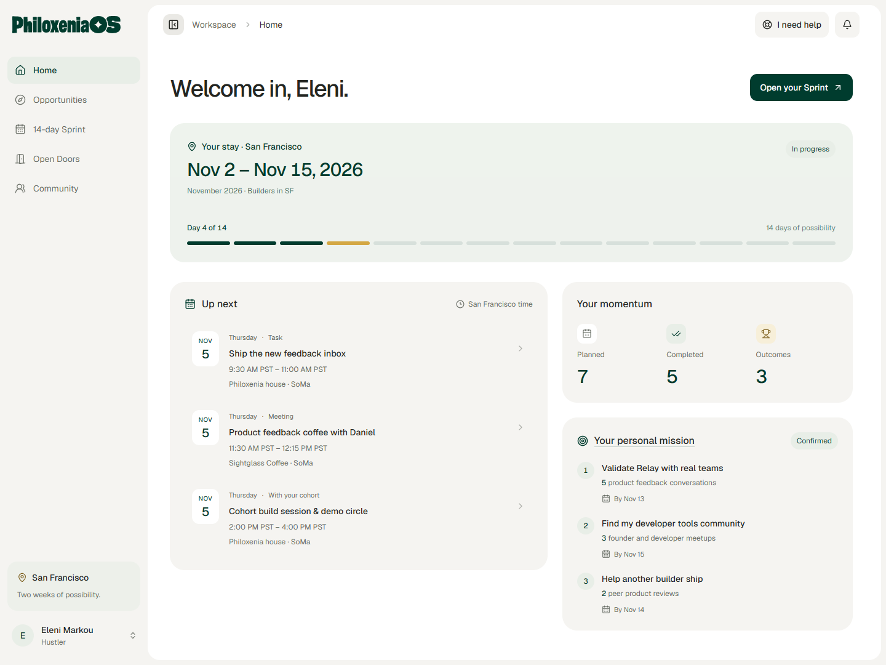
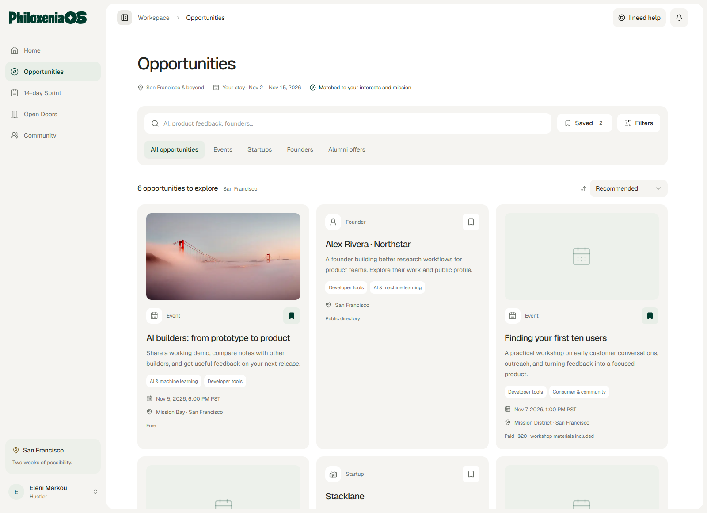
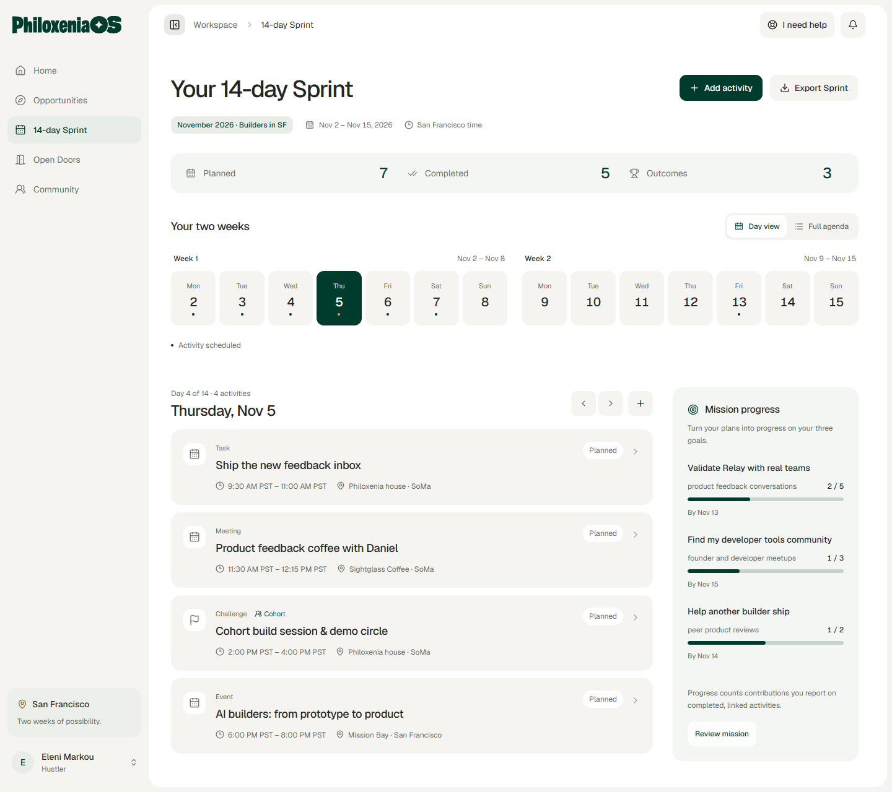
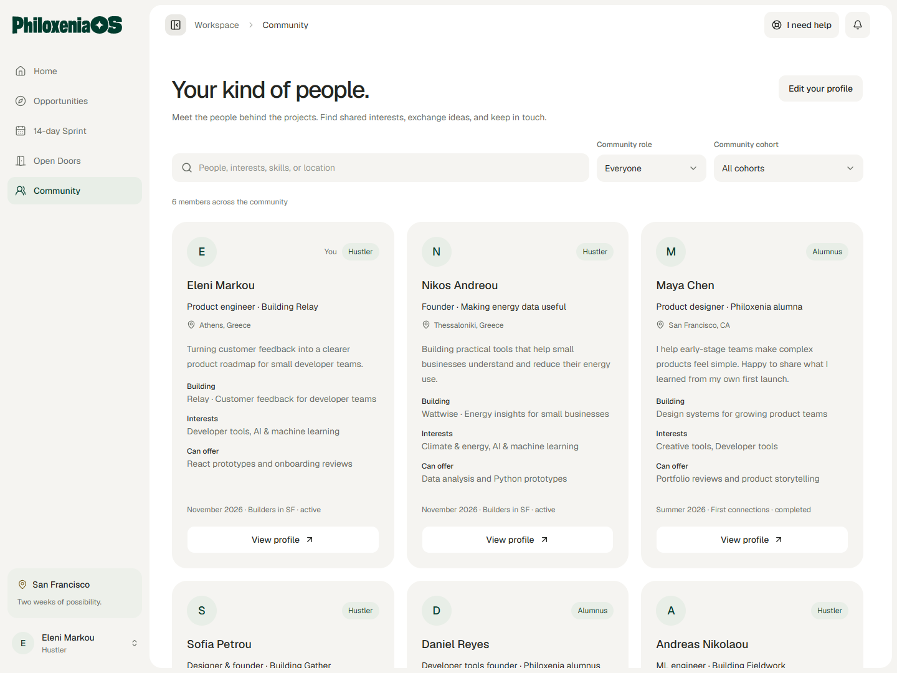
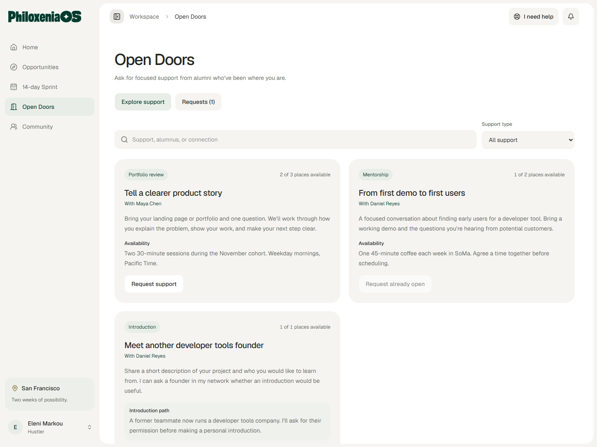
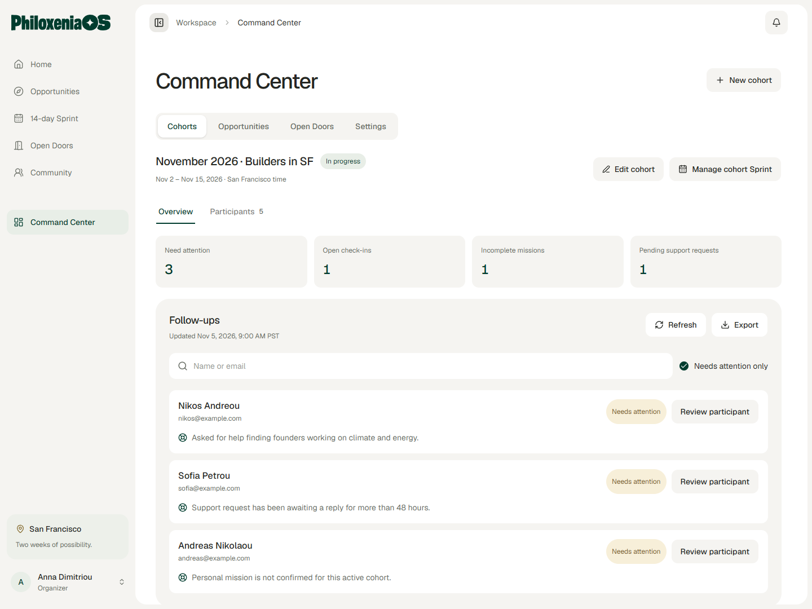

# Philoxenia OS

Philoxenia OS is the shared workspace for **Philoxenia by Hustle Hours**: two weeks of building, connecting, and opening doors in San Francisco. It helps participants turn their ambitions into a plan, find relevant opportunities, and stay connected with the community after their stay. Organizers can coordinate the program in the app or through their AI assistant with built-in MCP support.

[Open Philoxenia OS](https://philoxenia-os.socrates.fyi)

## Make the most of your two weeks

The screenshots below show the app with fictional example participants, projects, events, and support offers.

### Set your mission

Share what you’re building and what you hope to achieve. Get three suggested, measurable goals, then shape them into a mission that fits your stay. Your answers save as you go, so you can pick up where you left off. Home brings your confirmed goals, upcoming activities, and momentum together.

### Discover opportunities

Explore events, startups, founders, and alumni offers in San Francisco, the wider Bay Area, and online. Find recommendations with clear reasons, filter by your interests, and save opportunities for later.

### Plan your 14-day Sprint

Bring tasks, events, meetings, and cohort activities into one daily view or agenda. Add opportunities to your plan, spot scheduling conflicts, and export your Sprint to your calendar.

Record attendance, completed activities, contributions toward your goals, and outcomes such as feedback, meetings, and projects. Keep your plans and reported results clear. When you need support, send a help check-in to the organizers during onboarding or throughout your stay.

## A community that continues after the trip

Find fellow participants and alumni in the **Community** directory. Share what you’re building, your interests, and the skills you can offer, then search for people with relevant experience.

Through **Open Doors**, alumni can offer mentorship, portfolio reviews, introductions, and other support. Participants can request help, discuss an alternative, and add an agreed meeting to their Sprint. Alumni keep access to the community after graduation and can support future cohorts.

## One place for organizers

The **Command Center** brings the program together:

- Manage cohorts, invitations, participant access, and individual stay dates.
- Review missions, participant plans, and reported outcomes.
- Publish curated opportunities and bring in events from Luma and Google Events, plus startup listings from YC imports.
- Plan shared activities and challenges for each cohort.
- Follow up on help requests, keep private notes, and coordinate alumni support.
- Review cohort summaries, export reports, and check import and email delivery status.
- Connect an AI assistant to help with organizer workflows, with permissions organizers can review and revoke.

## Work with your AI assistant through MCP

Philoxenia OS supports **MCP (Model Context Protocol)**, so organizers can connect compatible assistants such as **Claude, ChatGPT, and Codex** and manage the program through conversation. A connected assistant can read current workspace records and, when given permission, make organizer updates directly in Philoxenia OS.

For example, ask your assistant to:

- “Show me who needs a follow-up in the November cohort and why.”
- “Draft an opportunity from this event link.”
- “Add a shared demo session to the cohort’s Sprint.”
- “Show unanswered alumni support requests and save my coordination note.”
- “Invite these participants to the next cohort.”

This covers cohorts and invitations, opportunity curation, shared Sprint activities, missions, participant follow-ups, and alumni support coordination. Updates appear in the same workspace organizers use in the app.

Organizers choose **read-only** or **read-and-write** access, can review connection activity, and can revoke each connection at any time. Connected assistants follow the app’s organizer access rules and checks for conflicting edits. Alumni decisions and participants’ personal Sprint changes stay with those members.

Start in **Command Center → Settings → Connect your agent**. See the [connection guide for Claude, ChatGPT, and Codex](MCP.md) for setup instructions.

## Built around an invited community

Access is by invitation. Members choose what to share on their community profile; private missions, support requests, and organizer notes have their own access controls. In-app notifications keep people informed about invitations and support, with email updates when enabled.

## Project documentation

For those maintaining the app: [development and operations](DEVELOPMENT.md), [release runbook](RELEASE.md), [agent connections](MCP.md), and [interface guidelines](GUI.md).
